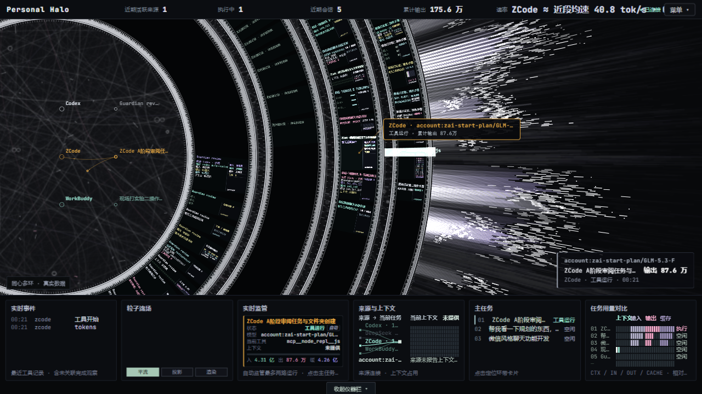
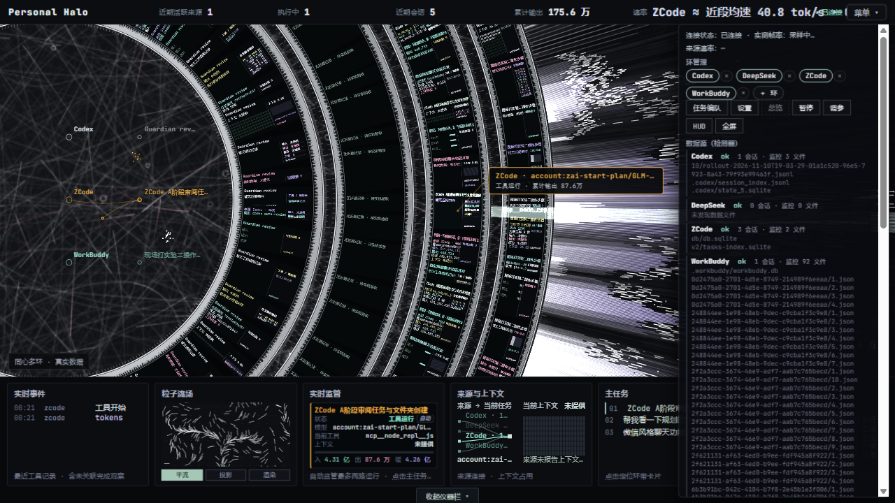

# Personal Halo · 个人 Agent 光环

<p align="center">
  
</p>

<p align="center">
  <strong>多环同心 · AI 编码代理实况可视化面板</strong><br>
  在一块画布上，同时呈现多个 AI 编码代理的真实工作状态
</p>

<p align="center">
  <a href="#-快速开始"></a>
  <a href="#-支持的来源"></a>
  <a href="#-许可"></a>
</p>

---

## 这是什么

一个运行在本机的实况可视化面板：统一采集器**只读**读取各 AI 编码代理的本地记录（SQLite / JSONL），经 HTTP/SSE 推送给一个 AGT 风格的「同心侧弧环」画面 —— 每个 Agent 一条独立的环，数据卡、内场节点、身份色彗星、速率指标，全部来自真实运行数据。

据我们所知，这是首个把**多个 AI 编码代理以多环同屏方式**呈现的开源实现。它不联网、不上报，一切都发生在你自己的机器上。

## 特性

- 🔭 **多环同屏** —— 从内到外 Codex → DeepSeek Harness → ZCode → WorkBuddy，每个 Agent 的会话卡片长在自己的环带上，互不混串
- 🪐 **AGT 式侧弧构图** —— 巨大偏心侧弧 + 左侧共享编织光场 + 右侧放射光束；内场编织亮线永远在流动，空闲也不会冻成截图
- 🖱️ **双击检查** —— 双击任意环，镜头凑近该环的数据卡持续跟踪（环转动卡位也跟着）；再双击或 Esc 回到总览节奏
- 📡 **真实速率** —— 「≈ 近段均速」由相邻两次完成用量检查点差分而来，标注更新时间与口径；空闲不冒充运行、未知不填零
- 🎨 **身份色系** —— 每个来源一个专属色，贯穿内场节点、执行引线浮标、身份彗星与底部仪器
- 🗂️ **数据源检测器** —— 菜单里直接看每个 Agent 监控中的数据文件、会话数与状态；添加新应用有明确契约
- 🧩 **双 Agent 监管** —— 底栏自动监管最多两路不同的运行来源，可手动锁定、可恢复自动；三路以上如实提示
- 🖼️ **壁纸模式** —— `?wallpaper=1` 一键纯画面，可作为 Wallpaper Engine 的 Web 壁纸地址
- 🔒 **隐私口径** —— 只读元数据（状态 / 用量 / 时间戳）；永不读取会话正文、工具输出与密钥

## 界面速览

**数据源检测器** —— 菜单里实时列出每个来源监控中的数据文件与健康状态：



## 快速开始

```bash
# 需要 Node.js ≥ 22.15（用到实验性 node:sqlite）
cd personal-halo
node src/index.js
```

打开 <http://127.0.0.1:47830/?rings=4>

- `?rings=1` / `?rings=2` / `?rings=4` —— 环数预览（仅本次）
- `?wallpaper=1` —— 壁纸模式
- 采集器与页面同一进程，无需另外起服务

## 玩法

### 来源环管理
顶栏右侧「菜单」→ 环管理：每个来源芯片带可见 `×`（隐藏该环，不停采集），「＋ 环」菜单恢复；偏好自动保存，下次打开保持。全部隐藏时只剩共享编织光场，画面依然是活的。

### 双击检查模式
双击任意环 → 镜头凑近该环正在运行的会话数据卡（标题、模型、当前工具、输入/输出/缓存、上下文），环在转动、镜头就跟着转；再双击任意处或按 Esc 退出，回到原来的动态节奏。

### 任务编队与设置
菜单 → 任务：四来源筛选（含「仅执行中」与真实父子关系）、来源概览（采集健康与会话数）、条目详情（输入/输出/缓存/上下文/工作目录，未知一律「未提供」）、点击可「定位环带 / 监管此任务」。菜单 → 设置：大屏名称、画面质量、安静模式、底栏显隐、引线浮标、自动跟随，保存后刷新保持。

### 粒子流场三模式
底栏「粒子流场」面板：**平流**（连续卷曲粒子）/ **投影**（方向场箭头）/ **渲染**（高亮粒子束与拖尾）—— 三种都是装饰可视化，不代表业务指标。

### 调参台
按 `C`（或菜单 → 调参）：56 项动势参数实时可调（节拍、亮线数量与速度、彗星、辉光、环停顿…），含「AGT 动势 / 本机流畅」预设。

### 壁纸模式
在地址后加 `&wallpaper=1`：纯画面、无控件、自动跟随。想让它常驻桌面：Wallpaper Engine → 创建壁纸 → Web 类型 → 填入面板 URL 即可（本项目不安装任何系统组件、不自启）。

## 支持的来源

| Agent | 身份色 | 本地数据文件 | 状态信号 |
| --- | --- | --- | --- |
| Codex | 银白 `#dfe6ee` | `~/.codex/sessions/**`（rollout JSONL + state SQLite） | thinking / tool / tokens 检查点 |
| DeepSeek Harness | 冰蓝 `#6ec8e8` | 会话多帧 zstd JSONL | thinking / streaming / tool |
| ZCode | 琥珀 `#e6a842` | `~/.zcode/cli/db/db.sqlite`、`tasks-index.sqlite` | thinking / streaming / tool / todos |
| WorkBuddy | 青绿 `#98e0cf` | `~/.workbuddy/workbuddy.db`、`tasks/<id>/*.json` | working 粗执行态 |

> 身份色固定不随机：同一来源在节点、浮标、彗星、仪器里永远是同一个颜色；模型名只用于细节强调，不改来源色。

## 添加你自己的应用

采集器是适配器化的 —— 给一个新 Agent 接入只需三步：

1. 在 `src/adapters/` 新建适配器，声明 `roots(home, env)`（数据文件路径）、`match(file)`（文件匹配）、`kind`（json-doc / jsonl / sqlite）与一个 `poll(ctx)`（产出**元数据信号**：meta / tokens / tool_start / tool_end / thinking / text / turn_*）
2. 在 `src/adapters/index.js` 注册
3. 完成 —— 发现、监控、会话窗口、隐私裁剪、速率检查点全部继承

信号只允许元数据；任何正文、密钥、工具输出都不会离开本机。

## 速率与数据口径

- 「≈ 近段均速」来自**相邻两次完成用量检查点的差分**（Δoutput ÷ Δ(源时间 completed_at)），在采集器内计算，标注更新时间；超过 10 分钟标注「已过期」
- 它**不是**逐 token 实时速率 —— 当前四个来源的本地记录都没有可核验的逐 token 时间数据；宁缺毋滥
- 只有采集器验证过的流式增量才会标注「实时输出」
- 空闲、等待、错误各显示真实状态；未知 token / 上下文一律「未提供」，绝不填零

## 致谢

- **[HALOFLUX](https://github.com/Ryder191/haloflux)** by Ryder191 —— 本项目的视觉与采集骨架源自它的 PolyForm Noncommercial 衍生链（HALOFLUX → agent-halo → personal-halo），同心侧弧环与编织光场的美学根基来自这部原作。致敬。
- [agent-halo](https://github.com/caihao373-star/agent-halo) —— 衍生链的中间层。

## 许可

[PolyForm Noncommercial 1.0.0](LICENSE)（继承上游授权链）—— 个人与非商业用途免费。衍生与署名链详见 [NOTICE](NOTICE)。
